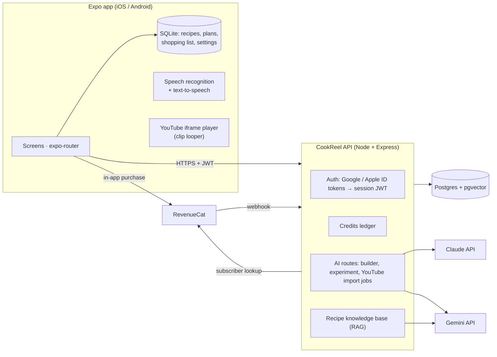

# CookReel

**Cook anything, one step at a time.** CookReel turns YouTube recipe videos into hands-free, step-by-step
reels and lets you design new dishes with an AI chef that knows your kitchen, your goals and your budget.


## What it does

| | |
|---|---|
| **YouTube → step reels** | Paste any recipe video or Short. Gemini watches it, Claude writes clean steps, and each step plays its own looping clip in a vertical, swipeable cook mode. Shorts get an AI voice that explains every step. |
| **Hands-free cooking** | Say “next”, “back”, “stop”, “repeat”, “ingredients”, “start timer”… (English and Hinglish). The mic pauses while the app is speaking, so narration can’t trigger commands. |
| **Chef, the AI recipe builder** | Describe a craving; Chef asks a few quick questions (always *how many people?*), then writes a recipe for your equipment, diet, time and skill. **Cook from my fridge** builds dishes from what you already have. |
| **Experiments** | One tap for “make it vegan”, “more protein”, “air fryer version”… Chef rewrites the recipe and shows the before → after macros. Variations are saved as new versions. |
| **Calories & macros everywhere** | Per-serving calories, protein, carbs, fat and fibre on every recipe, rescaled live when you change servings. Daily targets on the meal plan. |
| **Plan & shop** | Weekly meal planner, collections, “cook later” queue and an auto-grouped shopping list. |
| **Accounts & credits** | Continue with Google, Sign in with Apple (iOS), or no account at all. Everything that doesn’t use AI is free and works offline; AI features use credits (one-time starter credits, then subscriptions). |

Who it’s designed for (onboarding reorders Home for each):

- **Busy beginners** — students, gym-goers and people who work late. Quick, high-protein meals, few utensils, meal prep.
- **Savers** — keep YouTube recipes to cook later, organised into collections with a shopping list.
- **Food enthusiasts** — create new dishes and variations with Chef.
- **Everyone else** — beginner-friendly defaults, with tips and “what does *sauté* mean?” explanations inside every step.

## Architecture



- **Recipes stay on the phone** (SQLite). The server only stores accounts, the credit ledger, import jobs, cached video breakdowns and the recipe knowledge base. Guests need no account; the app only fetches current prices from the server.
- **Claude** (`claude-opus-5-5`, structured outputs) runs the builder interview, writes and rewrites recipes, and turns raw video breakdowns into clean recipes with per-step narration.
- **Gemini** (`gemini-3.5-flash`) watches the YouTube video by URL and returns timestamped steps; `gemini-embedding-001` powers the knowledge base.
- **Credits** are charged on the server inside a Postgres transaction (idempotency keys, row locks) and refunded automatically when an AI call fails.

```
app/      Expo SDK 57 app (TypeScript, expo-router, Reanimated, zustand)
server/   API server (Node 22, Express 5, Drizzle ORM, zod, vitest)
docs/     Screenshots
```

## Quick start

You need Node 22+. Neither part needs API keys to boot.

### 1. API server

```bash
cd server
cp .env.example .env        # works as-is for local development
npm install
npm run dev                 # http://localhost:8787
```

With `DATABASE_URL` empty the server uses an embedded Postgres (PGlite + pgvector) in `.data/pglite`, and
`ALLOW_DEV_LOGIN=true` adds a passwordless **Sign in for testing** button to development builds, so you can try
accounts and credits without Google/Apple. AI routes answer `503` until you add `ANTHROPIC_API_KEY` and `GEMINI_API_KEY`.

### 2. App

```bash
cd app
cp .env.example .env        # point EXPO_PUBLIC_API_URL at your server
npm install
npx expo run:ios            # or: npx expo run:android
```

CookReel uses native modules (speech recognition, Google Sign-In, RevenueCat, SQLite), so it needs a
**development build** — Expo Go is not enough. For a physical phone, set `EXPO_PUBLIC_API_URL` to your
computer’s LAN IP (Android emulators use `http://10.0.2.2:8787`). Cloud builds: `npx eas-cli@latest build --profile development`.

`npx expo start --web` runs a browser preview for UI work. Google/Apple sign-in and purchases are stubbed there;
voice uses the browser’s Web Speech API where available.

## Configuration

All server settings are documented in [`server/.env.example`](server/.env.example) and validated at boot
(in production the server refuses to start without `DATABASE_URL` and a 32+ character `JWT_SECRET`, or with dev login enabled). App settings live in
[`app/.env.example`](app/.env.example).

### AI providers

| Variable | Default | Notes |
|---|---|---|
| `ANTHROPIC_API_KEY` | — | Required for Chef, experiments and turning video breakdowns into recipes. |
| `CLAUDE_MODEL` | `claude-opus-5-5` | `claude-sonnet-5-5` costs half as much per token (see [Costs](#costs)). |
| `CLAUDE_EFFORT` | `medium` | `low` thinks less (cheaper, faster); `high` for harder recipes. |
| `CLAUDE_FALLBACKS` | `true` | Server-side refusal fallbacks (`fallbacks: "default"`). Set `false` behind Bedrock/Vertex/a proxy, or for a model without fallback support. |
| `GEMINI_API_KEY` | — | Required for YouTube imports and the knowledge base. |
| `GEMINI_MODEL` | `gemini-3.5-flash` | Watches the video. Regular videos are sampled at low media resolution; Shorts at 2 fps / medium resolution. |
| `GEMINI_EMBEDDING_MODEL` | `gemini-embedding-001` | 768-dimension embeddings. |

### Database

Production uses Postgres 15+ with the [pgvector](https://github.com/pgvector/pgvector) extension (Neon,
Supabase, RDS and Railway all support it). Set `DATABASE_URL`; migrations in `server/drizzle/` run
automatically at startup. After changing `server/src/db/schema.ts`, generate a migration with `npm run db:generate`.

### Sign in with Google

1. In Google Cloud console → Credentials, create OAuth client IDs: **Web** (always), **iOS**, and **Android**
   (register your signing certificate’s SHA-1, including EAS/Play signing keys).
2. App `.env`: `EXPO_PUBLIC_GOOGLE_WEB_CLIENT_ID`, `EXPO_PUBLIC_GOOGLE_IOS_CLIENT_ID`, and
   `GOOGLE_IOS_URL_SCHEME` (the iOS client ID reversed, e.g. `com.googleusercontent.apps.123-abc`).
   The config plugin is only added when the URL scheme is set.
3. Server `.env`: `GOOGLE_CLIENT_IDS` = the web client ID (the audience of the ID tokens the app sends).

### Sign in with Apple

1. Enable the *Sign in with Apple* capability for your bundle ID (`APP_BUNDLE_ID`, default `com.cookreel.app`).
2. Server `.env`: `APPLE_BUNDLE_IDS` = that bundle ID.
3. App Store review requires apps to revoke Apple tokens when an account is deleted. Create a *Sign in with
   Apple* key and set `APPLE_TEAM_ID`, `APPLE_KEY_ID` and `APPLE_PRIVATE_KEY` (the `.p8` contents; `\n`
   for newlines). Refresh tokens are stored encrypted and revoked on account deletion.

### Subscriptions and credits (RevenueCat)

In-app purchases go through the App Store / Google Play via [RevenueCat](https://www.revenuecat.com/).

1. Create the store products. Defaults (change them in a pricing file, below):
   - subscriptions `cookreel_basic_monthly`, `cookreel_basic_yearly`, `cookreel_pro_monthly`, `cookreel_pro_yearly`,
     `cookreel_max_monthly`, `cookreel_max_yearly` (on Google Play, products `cookreel_basic` / `cookreel_pro` /
     `cookreel_max` with base plans `monthly` and `yearly`);
   - consumable top-ups `cookreel_credits_50`, `cookreel_credits_150`, `cookreel_credits_500`.
2. In RevenueCat: attach the subscriptions to an entitlement named `cookreel_plus` (top-ups are only sold to
   subscribers) and put every product in the current offering.
3. App `.env`: `EXPO_PUBLIC_REVENUECAT_IOS_KEY`, `EXPO_PUBLIC_REVENUECAT_ANDROID_KEY` (public SDK keys).
4. Server `.env`: `REVENUECAT_SECRET_KEY` (secret v1 API key) and `REVENUECAT_WEBHOOK_AUTH`. Point a RevenueCat
   webhook at `https://<your-api>/api/billing/revenuecat` with that value as its `Authorization` header.

The app identifies purchasers with the CookReel user ID. The server never trusts webhook payloads for
balances: each event triggers a fresh read of the customer from RevenueCat, so retries and out-of-order
events are safe.

To change plans, credit amounts, credit costs or top-ups without an app release, point `PRICING_CONFIG_PATH`
at a JSON file shaped like `DEFAULT_PRICING` in [`server/src/domain/pricing.ts`](server/src/domain/pricing.ts).

## Credits and pricing

| Action | Credits |
|---|---|
| AI recipe from Chef (questions are free) | 1 |
| Recipe variation (experiment) | 1 |
| YouTube video breakdown | 3 |
| YouTube Short breakdown | 2 |
| Saving, planning, shopping lists, cook mode, voice control, replaying imported reels | free |

- **New accounts** get **20 one-time starter credits**. They’re granted once per Google/Apple identity — deleting
  the account and signing up again doesn’t grant them twice.
- **Plans** (Basic 60 / Pro 200 / Max 600 credits a month; monthly or yearly) refill to their allowance every month,
  yearly plans included. Unused plan credits don’t roll over.
- **Top-ups** add credits that never expire. Plan credits are always spent first.
- Videos are checked before you’re charged (it must exist and allow embedding). A failed or interrupted
  import is refunded automatically, and a video someone already imported is free.
- **Guests** can use everything except AI; every AI entry point offers sign-up instead.

## How Chef learns from imported videos

Fine-tuning a model on every user’s uploads would be slow, expensive and impossible to undo when someone
deletes their data. CookReel gets the same benefit with a **knowledge base** (retrieval-augmented generation):

1. Every analysed video becomes a structured recipe. Its summary — ingredients, ratios, techniques, timings;
   never the video itself — is embedded with Gemini and stored in Postgres/pgvector.
2. When you ask Chef for a recipe or a variation, the server retrieves the most similar recipes from your own
   imports and the shared pool (above a similarity threshold) and gives them to Claude as reference examples.
3. The more videos people import, the better the ratios, techniques and flavour pairings Chef suggests — instantly,
   with no retraining.

Sharing is opt-in per user (**Me → Help Chef learn from my imports**). Turning it off or deleting the account
removes that user’s contributions from the shared pool.

## YouTube reels and platform rules

- Videos play in the **official YouTube embedded player** (`react-native-youtube-iframe`). CookReel never downloads,
  cuts or re-hosts video. A “clip” is just seeking to the step’s start and jumping back at its end.
- Nothing is drawn over the player; step text and controls sit below it.
- Shorts narration is spoken on the device with text-to-speech (`expo-speech`). The video keeps its own audio
  unless the cook mutes it.
- `react-native-youtube-iframe` loads its player page from `lonelycpp.github.io` by default. For production,
  host that page yourself and pass `baseUrlOverride` (see `app/src/features/cook/YouTubeStage.tsx`).
- Imports that aren’t embeddable (private, removed, or embedding disabled) are rejected before any credits are used.

## Voice commands

Short phrases work on their own. Longer sentences need the wake word — “Hey Chef, go to the next step” — so
the video’s own audio can’t trigger anything.

| Say | Does |
|---|---|
| next · skip · go on · *aage* · *agla* | Next step |
| back · previous · last step · *peeche* | Previous step |
| stop · pause · wait · *ruko* | Pause the clip |
| play · resume · continue · *chalao* | Resume |
| repeat · again · *phir se* · *dobara* | Replay the clip and narration |
| read · explain · tell me · *batao* | Read the step aloud |
| ingredients · what do I need | Read the ingredient list |
| start timer / stop timer | Step timer |
| help · what can I say | Show the commands |
| exit · I’m done · *band karo* | Leave cook mode |

## Tests and checks

```bash
cd server && npm run typecheck && npm test     # 71 tests: credits ledger, billing, auth, API, YouTube parsing, RAG
cd app && npm run typecheck && npm run lint && npm test   # 52 tests: voice commands, formatting, shopping list, ingredient parsing, YouTube links
cd app && npx expo export --platform android  # confirms the Hermes bundle builds
```

Server tests run against the embedded Postgres with fake Claude/Gemini/RevenueCat clients, so they need no
keys or network. Things that need a real device and real accounts:

- [ ] Import a regular video and a Short; swipe between steps; check that each clip loops on its step.
- [ ] Say “next”, “back”, “stop”, “repeat”, “start timer” while a video plays (try speaker and earphones).
- [ ] Sign in with Google (iOS + Android) and Apple; delete the account; sign in again — no second starter grant.
- [ ] Buy a plan and a top-up in sandbox; renew; cancel; restore purchases on a second device.

## Deploying

- **API:** `server/Dockerfile` builds a production image (`docker build -t cookreel-api server`). Run it with
  `NODE_ENV=production`, `DATABASE_URL`, `JWT_SECRET`, the AI keys, sign-in and RevenueCat variables, and
  `ALLOW_DEV_LOGIN` unset. `GET /health` reports which features (AI, YouTube, Google, Apple, billing) are configured.
- **App:** build and submit with EAS (`npx eas-cli@latest build`, `npx eas-cli@latest submit`). Set the
  `EXPO_PUBLIC_*` variables as EAS environment variables.

## Costs

Every Claude and Gemini call logs its token usage — measure real traffic before you fix prices. Rough
guide for Claude Opus 5.5 ($4 / $20 per million input/output tokens):

- a finished recipe or variation is roughly 4–6K input and 3–6K output tokens (including thinking): **≈ $0.08–0.15**;
- each free question turn in the builder: **≈ $0.02–0.05**;
- a YouTube import adds Gemini’s video tokens to a Claude pass of similar size.

The placeholder plans sell credits at roughly **$0.02–0.05 each** (Basic monthly: $2.99 for 60; Max yearly:
$119.99 for 7,200), before the store’s 15–30% fee. With Opus 5.5 that doesn’t cover a 1-credit recipe. Before launch, raise prices or credit costs
(via `PRICING_CONFIG_PATH`), switch `CLAUDE_MODEL` to `claude-sonnet-5-5` (half the per-token price), or set
`CLAUDE_EFFORT=low`.
