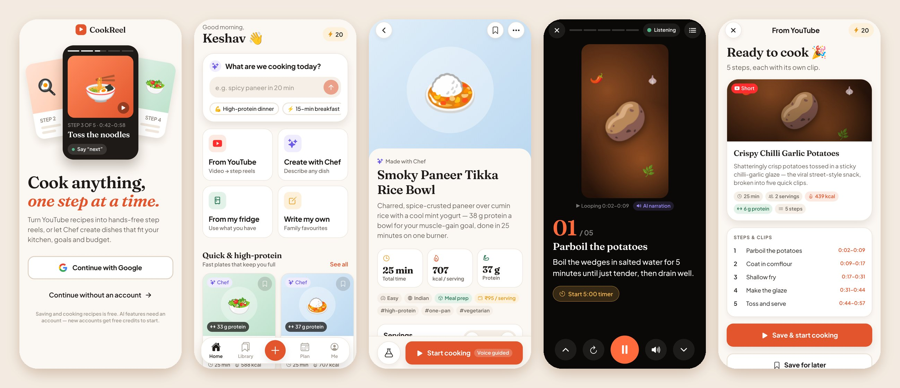
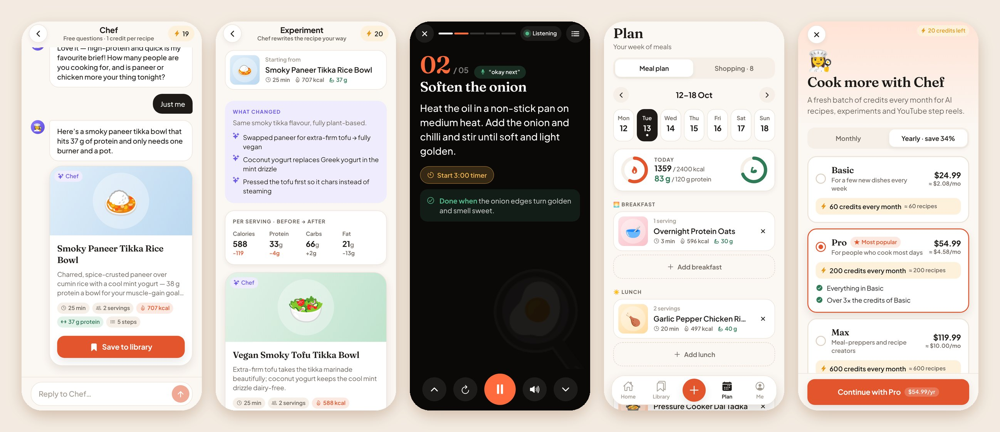
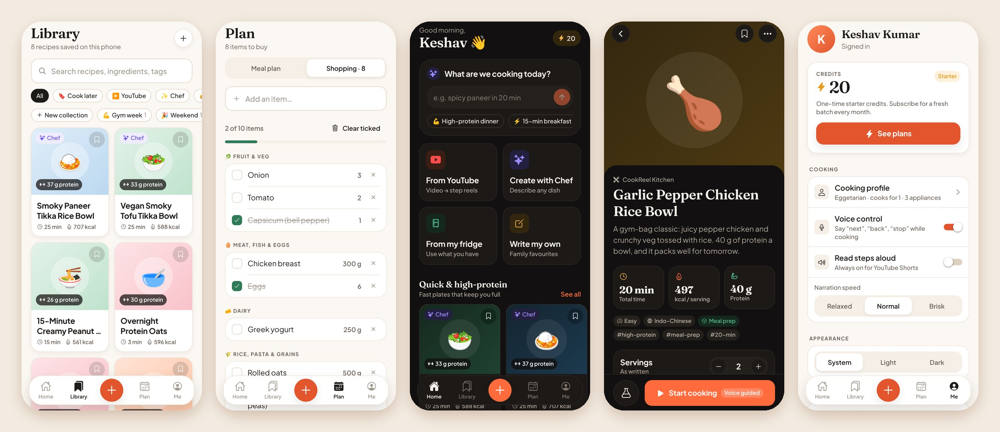
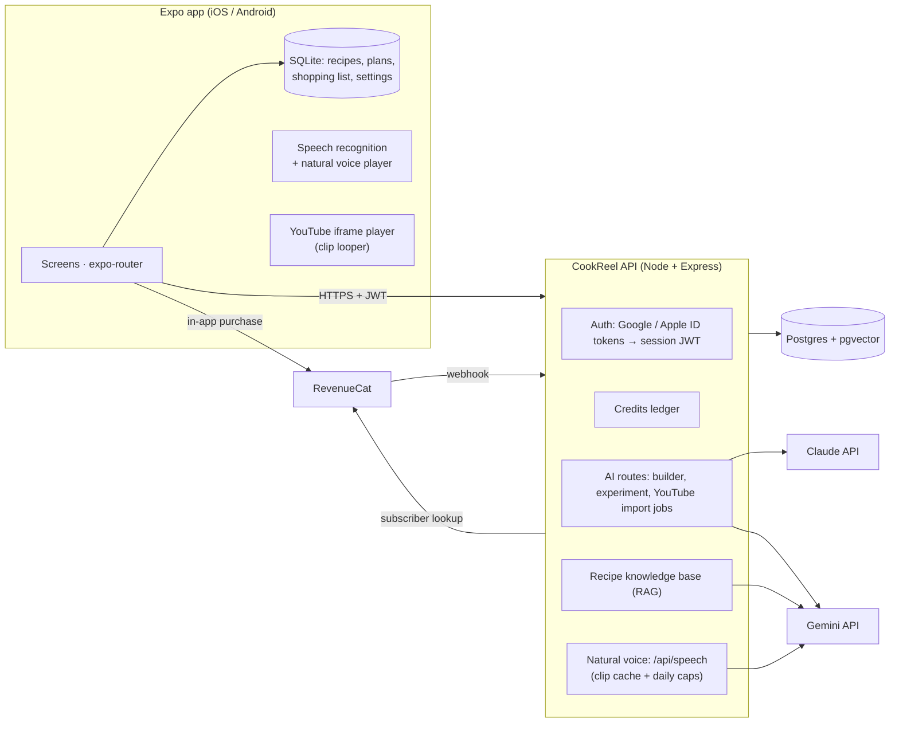

# CookReel

**Cook anything, one step at a time.** CookReel turns YouTube recipe videos into hands-free, step-by-step
reels and lets you design new dishes with an AI chef that knows your kitchen, your goals and your budget.





## What it does

| | |
|---|---|
| **YouTube → step reels** | Paste any recipe video or Short. Gemini watches it, Claude writes clean steps, and each step plays its own looping clip in a vertical, swipeable cook mode. Shorts get Chef’s voice explaining every step. |
| **8 languages** | English, Spanish, French, German, Portuguese (Brazil), Italian, Arabic (right-to-left) and Japanese — menus, Chef’s recipes, YouTube recipes, voice commands and narration. Follows the phone’s language, or pick one in **Me → App language**. |
| **A natural voice** | Chef reads steps in a warm, human-sounding voice in every language (Gemini TTS), cached so each step is generated once. While a clip is still being generated, a thin progress line sweeps above the controls. Guests and offline cooks hear the most natural voice installed on the phone. |
| **Hands-free cooking** | Say “next”, “back”, “stop”, “repeat”, “ingredients”, “start timer”… in the app’s language (plus Hinglish in English). The mic rests while Chef speaks, so narration can’t trigger commands. |
| **Chef, the AI recipe builder** | Describe a craving; Chef asks a few quick questions (always *how many people?*), then writes a recipe for your equipment, diet, time and skill. **Cook from my fridge** builds dishes from what you already have. |
| **Experiments** | One tap for “make it vegan”, “more protein”, “air fryer version”… Chef rewrites the recipe and shows the before → after macros. Variations are saved as new versions. |
| **Calories & macros everywhere** | Per-serving calories, protein, carbs, fat and fibre on every recipe, rescaled live when you change servings. Daily targets on the meal plan. |
| **Plan & shop** | Weekly meal planner, collections, “cook later” queue and an auto-grouped shopping list. |
| **Accounts & credits** | Continue with Google, Sign in with Apple (iOS), or no account at all. Everything that doesn’t use AI is free and works offline; AI features use credits (one-time starter credits, then subscriptions). |

Who it’s designed for (onboarding reorders Home for each):

- **Busy beginners** — students, gym-goers and people who work late. Quick, high-protein meals, few utensils, meal prep.
- **Savers** — keep YouTube recipes to cook later, organised into collections with a shopping list.
- **Food enthusiasts** — create new dishes and variations with Chef.
- **Everyone else** — beginner-friendly defaults, with tips and “what does *sauté* mean?” explanations inside every step.

## Architecture



- **Recipes stay on the phone** (SQLite). The server only stores accounts, the credit ledger, import jobs, cached video breakdowns (and their translations), the recipe knowledge base and cached narration clips. Guests need no account; the app only fetches current prices from the server.
- **Claude** (`claude-opus-5-5`, structured outputs) runs the builder interview, writes and rewrites recipes, and turns raw video breakdowns into clean recipes with per-step narration.
- **Gemini** (`gemini-3.5-flash`) watches the YouTube video by URL and returns timestamped steps; `gemini-embedding-001` powers the knowledge base; `gemini-3.8-flash-tts` speaks the narration.
- **Credits** are charged on the server inside a Postgres transaction (idempotency keys, row locks) and refunded automatically when an AI call fails.

```
app/      Expo SDK 57 app (TypeScript, expo-router, Reanimated, zustand)
server/   API server (Node 22, Express 5, Drizzle ORM, zod, vitest)
docs/     Screenshots
```

## Quick start

You need Node 22+. Neither part needs API keys to boot.

### 1. API server

```bash
cd server
cp .env.example .env        # works as-is for local development
npm install
npm run dev                 # http://localhost:8787
```

With `DATABASE_URL` empty the server uses an embedded Postgres (PGlite + pgvector) in `.data/pglite`, and
`ALLOW_DEV_LOGIN=true` adds a passwordless **Sign in for testing** button to development builds, so you can try
accounts and credits without Google/Apple. AI routes answer `503` until you add `ANTHROPIC_API_KEY` and `GEMINI_API_KEY`.

### 2. App

```bash
cd app
cp .env.example .env        # point EXPO_PUBLIC_API_URL at your server
npm install
npx expo run:ios            # or: npx expo run:android
```

CookReel uses native modules (speech recognition, Google Sign-In, RevenueCat, SQLite), so it needs a
**development build** — Expo Go is not enough. For a physical phone, set `EXPO_PUBLIC_API_URL` to your
computer’s LAN IP (Android emulators use `http://10.0.2.2:8787`). Cloud builds: `npx eas-cli@latest build --profile development`.

`npx expo start --web` runs a browser preview for UI work. Google/Apple sign-in and purchases are stubbed there;
voice uses the browser’s Web Speech API where available.

## Configuration

All server settings are documented in [`server/.env.example`](server/.env.example) and validated at boot
(in production the server refuses to start without `DATABASE_URL` and a 32+ character `JWT_SECRET`, or with dev login enabled). App settings live in
[`app/.env.example`](app/.env.example).

### AI providers

| Variable | Default | Notes |
|---|---|---|
| `ANTHROPIC_API_KEY` | — | Required for Chef, experiments and turning video breakdowns into recipes. |
| `CLAUDE_MODEL` | `claude-opus-5-5` | `claude-sonnet-5-5` costs half as much per token (see [Costs](#costs)). |
| `CLAUDE_EFFORT` | `medium` | `low` thinks less (cheaper, faster); `high` for harder recipes. |
| `CLAUDE_FALLBACKS` | `true` | Server-side refusal fallbacks (`fallbacks: "default"`). Set `false` behind Bedrock/Vertex/a proxy, or for a model without fallback support. |
| `GEMINI_API_KEY` | — | Required for YouTube imports and the knowledge base. |
| `GEMINI_MODEL` | `gemini-3.5-flash` | Watches the video. Regular videos are sampled at low media resolution; Shorts at 2 fps / medium resolution. |
| `GEMINI_EMBEDDING_MODEL` | `gemini-embedding-001` | 768-dimension embeddings. |

### Natural voice

| Variable | Default | Notes |
|---|---|---|
| `TTS_ENABLED` | `true` | Needs `GEMINI_API_KEY`. Off: everyone hears the phone’s own voice. |
| `GEMINI_TTS_MODEL` | `gemini-3.8-flash-tts` | `gemini-3.8-flash-lite-tts` is cheaper. |
| `TTS_VOICES` | `warm:Sulafat,friendly:Achird,gentle:Vindemiatrix,easygoing:Callirrhoe` | App voice id → Gemini voice; the first is the default. The app shows the ids it gets from `/health`. |
| `TTS_USER_DAILY_SECONDS` | `900` | Seconds of *new* narration per cook per day (cached clips are free). |
| `TTS_GLOBAL_DAILY_SECONDS` | `50000` | Daily ceiling for the whole service — a cost guard. |
| `GEMINI_TTS_STYLE` | `true` | Sends the delivery direction (warm home cook, pace, accent) as speech metadata, never as text to read. |
| `GEMINI_TTS_LANGUAGE_CODE` | `true` | Sends the ISO language code; the server retries without it if the API rejects it. |
| `TTS_CACHE_VERSION` | `1` | Bump to discard every cached clip after changing voices or style. |

### Database

Production uses Postgres 15+ with the [pgvector](https://github.com/pgvector/pgvector) extension (Neon,
Supabase, RDS and Railway all support it). Set `DATABASE_URL`; migrations in `server/drizzle/` run
automatically at startup. After changing `server/src/db/schema.ts`, generate a migration with `npm run db:generate`.

### Sign in with Google

1. In Google Cloud console → Credentials, create OAuth client IDs: **Web** (always), **iOS**, and **Android**
   (register your signing certificate’s SHA-1, including EAS/Play signing keys).
2. App `.env`: `EXPO_PUBLIC_GOOGLE_WEB_CLIENT_ID`, `EXPO_PUBLIC_GOOGLE_IOS_CLIENT_ID`, and
   `GOOGLE_IOS_URL_SCHEME` (the iOS client ID reversed, e.g. `com.googleusercontent.apps.123-abc`).
   The config plugin is only added when the URL scheme is set.
3. Server `.env`: `GOOGLE_CLIENT_IDS` = the web client ID (the audience of the ID tokens the app sends).

### Sign in with Apple

1. Enable the *Sign in with Apple* capability for your bundle ID (`APP_BUNDLE_ID`, default `com.cookreel.app`).
2. Server `.env`: `APPLE_BUNDLE_IDS` = that bundle ID.
3. App Store review requires apps to revoke Apple tokens when an account is deleted. Create a *Sign in with
   Apple* key and set `APPLE_TEAM_ID`, `APPLE_KEY_ID` and `APPLE_PRIVATE_KEY` (the `.p8` contents; `\n`
   for newlines). Refresh tokens are stored encrypted and revoked on account deletion.

### Subscriptions and credits (RevenueCat)

In-app purchases go through the App Store / Google Play via [RevenueCat](https://www.revenuecat.com/).

1. Create the store products. Defaults (change them in a pricing file, below):
   - subscriptions `cookreel_basic_monthly`, `cookreel_basic_yearly`, `cookreel_pro_monthly`, `cookreel_pro_yearly`,
     `cookreel_max_monthly`, `cookreel_max_yearly` (on Google Play, products `cookreel_basic` / `cookreel_pro` /
     `cookreel_max` with base plans `monthly` and `yearly`);
   - consumable top-ups `cookreel_credits_50`, `cookreel_credits_150`, `cookreel_credits_500`.
2. In RevenueCat: attach the subscriptions to an entitlement named `cookreel_plus` (top-ups are only sold to
   subscribers) and put every product in the current offering.
3. App `.env`: `EXPO_PUBLIC_REVENUECAT_IOS_KEY`, `EXPO_PUBLIC_REVENUECAT_ANDROID_KEY` (public SDK keys).
4. Server `.env`: `REVENUECAT_SECRET_KEY` (secret v1 API key) and `REVENUECAT_WEBHOOK_AUTH`. Point a RevenueCat
   webhook at `https://<your-api>/api/billing/revenuecat` with that value as its `Authorization` header.

The app identifies purchasers with the CookReel user ID. The server never trusts webhook payloads for
balances: each event triggers a fresh read of the customer from RevenueCat, so retries and out-of-order
events are safe.

To change plans, credit amounts, credit costs or top-ups without an app release, point `PRICING_CONFIG_PATH`
at a JSON file shaped like `DEFAULT_PRICING` in [`server/src/domain/pricing.ts`](server/src/domain/pricing.ts).

## Credits and pricing

| Action | Credits |
|---|---|
| AI recipe from Chef (questions are free) | 1 |
| Recipe variation (experiment) | 1 |
| YouTube video breakdown | 3 |
| YouTube Short breakdown | 2 |
| Saving, planning, shopping lists, cook mode, voice control, replaying imported reels | free |

- **New accounts** get **20 one-time starter credits**. They’re granted once per Google/Apple identity — deleting
  the account and signing up again doesn’t grant them twice.
- **Plans** (Basic 60 / Pro 200 / Max 600 credits a month; monthly or yearly) refill to their allowance every month,
  yearly plans included. Unused plan credits don’t roll over.
- **Top-ups** add credits that never expire. Plan credits are always spent first.
- Videos are checked before you’re charged (it must exist and allow embedding). A failed or interrupted
  import is refunded automatically, and a video someone already imported is free.
- **Guests** can use everything except AI; every AI entry point offers sign-up instead.

## How Chef learns from imported videos

Fine-tuning a model on every user’s uploads would be slow, expensive and impossible to undo when someone
deletes their data. CookReel gets the same benefit with a **knowledge base** (retrieval-augmented generation):

1. Every analysed video becomes a structured recipe. Its summary — ingredients, ratios, techniques, timings;
   never the video itself — is embedded with Gemini and stored in Postgres/pgvector.
2. When you ask Chef for a recipe or a variation, the server retrieves the most similar recipes from your own
   imports and the shared pool (above a similarity threshold) and gives them to Claude as reference examples.
3. The more videos people import, the better the ratios, techniques and flavour pairings Chef suggests — instantly,
   with no retraining.

Sharing is opt-in per user (**Me → Help Chef learn from my imports**). Turning it off or deleting the account
removes that user’s contributions from the shared pool.

## Languages

| | Register | Notes |
|---|---|---|
| English | friendly, plain | Hinglish voice commands too |
| Español | informal *tú*, neutral | |
| Français | *vous* | French typography (non-breaking spaces) |
| Deutsch | informal *du* | |
| Português | Brazilian, *você* | |
| Italiano | informal *tu* | |
| العربية | Modern Standard Arabic, gender-neutral where possible | right-to-left layout, Western digits |
| 日本語 | です/ます | system fonts, Japanese units (大さじ, 小さじ, 個…) |

- **Choosing a language.** The app follows the phone’s language (falling back to English) or the one picked in
  **Me → App language** or on the welcome screen. CookReel restarts in the new language — Arabic needs a restart for
  its right-to-left layout anyway. All copy lives in typed catalogs (`app/src/i18n/messages/<lang>/`): a missing or
  extra key is a type error, and `catalogs.test.ts` checks placeholders and plural forms (Arabic uses all six CLDR
  plural categories; Japanese one).
- **Chef writes in the cook’s language.** Requests carry the app language and the prompt asks for it in the user turn,
  so the cached system prompts are identical for every language. If the cook types in another language, Chef answers
  in that one. Recipes record their language, and narration and spoken timers use the recipe’s language.
- **Units are stored as codes** (`tbsp`, `g`, `clove`…), so “2 cucharadas”, “2 EL” and “大さじ2” are the same amount;
  each language shows them its own way.
- **YouTube recipes are analysed once.** A video imported in one language is translated for cooks who ask for it in
  another — free for them, stored and shared, with quantities, timings, clips and nutrition copied from the original.
- **Starter recipes** that the cook hasn’t edited are shown in the app language.
- **Adding a language:** a catalog folder, starter recipe text (`app/src/data/starterRecipes.i18n/`), a voice lexicon
  in `app/src/lib/voice.ts`, `app/locales/<lang>.json` for permission prompts, and the code in
  `server/src/domain/languages.ts`.

## Natural voice

- Signed-in cooks hear Chef’s natural voice: the app sends the text to speak to `POST /api/speech`, which asks
  **Gemini 3.8 Flash TTS** for audio with a delivery direction — a warm home cook talking a friend through the recipe,
  at the cook’s pace (Relaxed / Normal / Brisk), with a Brazilian accent for Portuguese. The direction travels as
  speech metadata, so it is never read out.
- The server trims long silences, fades the edges and encodes 48 kbps MP3 (the Gemini audio is WAV/PCM). Clips are
  cached in Postgres for everyone (keyed by text, language, voice, pace and model) and on the phone, so a step is
  generated once. Clips nobody played for 90 days are pruned.
- Cooking mode asks for the current step and the next two only when narration is on. If a clip isn’t ready within a
  few seconds (1.5 s for timer alarms), or the cook is a guest, offline or over the daily allowance, the phone’s own
  voice reads it instead — the best installed one (Apple’s Premium/Enhanced voices, an offline Android voice).
- **Progress line:** while Chef’s voice is being generated, a thin line sweeps across the top of the cooking controls
  (a gentle pulse with Reduce Motion on). It appears only after 250 ms, so cached clips never flash it, and after a
  moment it’s joined by “Getting Chef’s voice ready…”. The same line shows in the ingredients sheet and when
  sampling voices in **Me → Voice and narration**.
- **Privacy:** the text being narrated (recipe steps, timer and ingredient phrases) is sent to Google’s Gemini API to
  make the audio. Nothing about the cook is sent with it.

## YouTube reels and platform rules

- Videos play in the **official YouTube embedded player** (`react-native-youtube-iframe`). CookReel never downloads,
  cuts or re-hosts video. A “clip” is just seeking to the step’s start and jumping back at its end.
- Nothing is drawn over the player; step text and controls sit below it.
- While Chef is speaking (and while the voice is being prepared) the video is muted; its own sound comes back when
  Chef is done, unless the cook muted it. Shorts are always narrated.
- `react-native-youtube-iframe` loads its player page from `lonelycpp.github.io` by default. For production,
  host that page yourself and pass `baseUrlOverride` (see `app/src/features/cook/YouTubeStage.tsx`).
- Imports that aren’t embeddable (private, removed, or embedding disabled) are rejected before any credits are used.

## Voice commands

The recogniser listens in the app language (in the cook’s regional variant when there is one, e.g. es-MX). Short
phrases work on their own; longer sentences need the wake word — “Hey Chef, go to the next step”, «Oye Chef…»,
「ねえシェフ…」, «يا شيف…» — so the video’s own audio can’t trigger anything. Words that are everyday speech (Spanish
*para*, German *halt*, Japanese 次に…) only count said on their own.

| | Next | Back | Pause | Resume | Repeat | Read | Timer |
|---|---|---|---|---|---|---|---|
| English | next · skip · *aage* | back · previous · *peeche* | stop · wait · *ruko* | play · continue | repeat · again · *phir se* | read · explain | start timer |
| Español | siguiente | atrás · anterior | pausa · espera | sigue · continúa | repite · otra vez | lee · explícame | pon el temporizador |
| Français | suivant | retour · précédent | pause · attends | reprends · continue | répète · encore | lis · explique | lance le minuteur |
| Deutsch | weiter · nächster | zurück | Pause · warte | fortsetzen | nochmal | vorlesen · erklär | Timer starten |
| Português | próximo | voltar · anterior | pausa · espera | continua | repete · de novo | lê · explica | inicia o timer |
| Italiano | avanti | indietro | pausa · aspetta | riprendi · continua | ripeti | leggi · spiega | avvia il timer |
| العربية | التالي | السابق · ارجع | توقف · انتظر | تابع · استمر | أعد · كرر | اقرأ · اشرح | شغّل المؤقت |
| 日本語 | 次へ | 戻って | ストップ · 待って | 再生 · 続けて | もう一回 | 読んで | タイマースタート |

Every language also has “ingredients”, “help”, “stop the timer” and “exit” phrases, and Spanish, French, German,
Portuguese and Italian understand the English commands too. The full lists are in `app/src/lib/voice.ts`.

## Tests and checks

```bash
cd server && npm run typecheck && npm test     # 101 tests: credits, billing, auth, API, YouTube, RAG, languages, natural voice
cd app && npm run typecheck && npm run lint && npm test   # 52 tests: voice commands, formatting, shopping list, ingredient parsing, YouTube links
cd app && npx expo export --platform android  # confirms the Hermes bundle builds
```

Server tests run against the embedded Postgres with fake Claude/Gemini/RevenueCat clients, so they need no
keys or network. Things that need a real device and real accounts:

- [ ] Import a regular video and a Short; swipe between steps; check that each clip loops on its step.
- [ ] Say “next”, “back”, “stop”, “repeat”, “start timer” while a video plays (try speaker and earphones), in English and at least one other language.
- [ ] With a real `GEMINI_API_KEY`: listen to every voice in every language; narration plays through the speaker, over the silent switch, while voice commands keep working, and the video’s sound comes back afterwards.
- [ ] Switch the app to Arabic on a release build: it restarts once into a right-to-left layout, and back to English restarts once into left-to-right.
- [ ] Switch the phone’s language with **Phone language** selected: the app follows it.
- [ ] Sign in with Google (iOS + Android) and Apple; delete the account; sign in again — no second starter grant.
- [ ] Buy a plan and a top-up in sandbox; renew; cancel; restore purchases on a second device.

## Deploying

- **API:** `server/Dockerfile` builds a production image (`docker build -t cookreel-api server`). Run it with
  `NODE_ENV=production`, `DATABASE_URL`, `JWT_SECRET`, the AI keys, sign-in and RevenueCat variables, and
  `ALLOW_DEV_LOGIN` unset. `GET /health` reports which features (AI, YouTube, Google, Apple, billing) are configured.
- **App:** build and submit with EAS (`npx eas-cli@latest build`, `npx eas-cli@latest submit`). Set the
  `EXPO_PUBLIC_*` variables as EAS environment variables.

## Costs

Every Claude and Gemini call logs its token usage, and every narration clip its length — measure real traffic before
you fix prices. Rough guide for Claude Opus 5.5 ($4 / $20 per million input/output tokens):

- a finished recipe or variation is roughly 4–6K input and 3–6K output tokens (including thinking): **≈ $0.08–0.15**;
- each free question turn in the builder: **≈ $0.02–0.05**;
- a YouTube import adds Gemini’s video tokens to a Claude pass of similar size;
- translating an analysed video for a new language is one low-effort Claude pass (**≈ $0.05–0.10**), once per
  video and language;
- **natural voice:** Gemini 3.8 Flash TTS bills about 25 audio tokens per second of speech — $9 per million audio
  tokens until 2026-12-31, then $18 ([pricing](https://ai.google.dev/gemini-api/docs/models/gemini-3.8-flash-tts)),
  i.e. **≈ $0.014 per narrated minute, ≈ $0.027 from 2027** (text input is negligible). A typical recipe is 1–2
  minutes of narration and is generated once for everyone; replays and other cooks’ plays are free. The caps bound
  the worst case: 900 s per cook per day ≈ $0.20 (≈ $0.41 from 2027), and `TTS_GLOBAL_DAILY_SECONDS` ≈ $11 a day at
  the default (≈ $22 from 2027).

The placeholder plans sell credits at roughly **$0.02–0.05 each** (Basic monthly: $2.99 for 60; Max yearly:
$119.99 for 7,200), before the store’s 15–30% fee. With Opus 5.5 that doesn’t cover a 1-credit recipe. Before launch, raise prices or credit costs
(via `PRICING_CONFIG_PATH`), switch `CLAUDE_MODEL` to `claude-sonnet-5-5` (half the per-token price), or set
`CLAUDE_EFFORT=low`.
